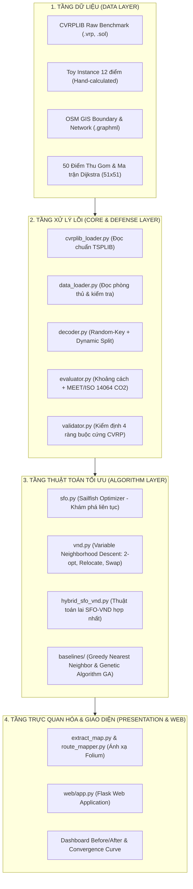
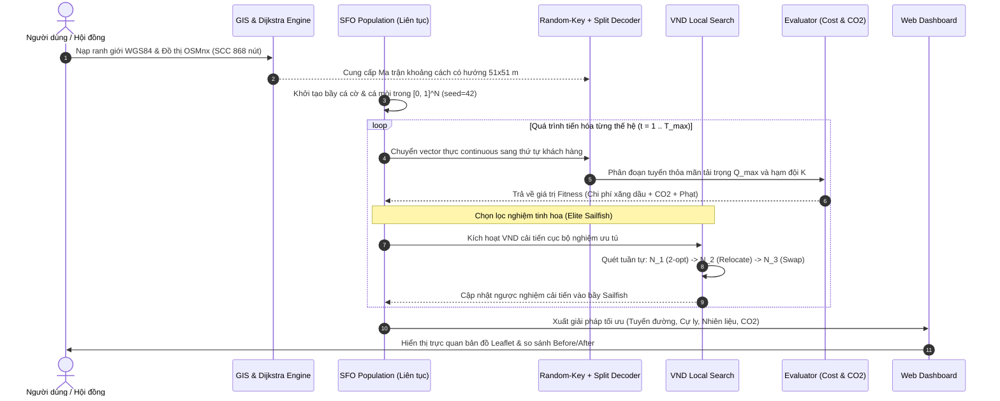

# 🏛️ KIẾN TRÚC HỆ THỐNG VÀ THIẾT KẾ THUẬT TOÁN LAI SFO-VND
## System Architecture & Algorithm Design Specification

> **Đơn vị đào tạo:** Trường Đại học Công Thương Thành phố Hồ Chí Minh (HUIT)  
> **Khoa/Ngành:** Ngành Khoa học Dữ liệu  
> **Đề tài NCKH:** Tối ưu hóa lộ trình thu gom rác thải đô thị nhằm giảm chi phí và phát thải carbon bằng thuật toán Sailfish Optimizer lai Variable Neighborhood Descent (SFO-VND)  
> **Giai đoạn:** Chuẩn hóa kiến trúc & Chuyển giao từ Step 2 sang Step 3  
> **Nhóm thực hiện:** Vũ Thế Quang (Nhóm trưởng), Lê Nguyễn Tâm Đức, Nguyễn Ngọc Thảo Hiền  

---

## 📌 1. TỔNG QUAN KIẾN TRÚC PHÂN TẦNG (TIERED ARCHITECTURE)

Hệ thống được thiết kế theo mô hình phân tầng chặt chẽ (Separation of Concerns), bảo đảm tính module hóa cao, tính tái lập độc lập và khả năng mở rộng trong tương lai:

---

## 🔄 2. QUY TRÌNH LUỒNG DỮ LIỆU & TỐI ƯU HÓA (DATA FLOW PIPELINE)

Quy trình giải quyết bài toán Green Capacitated Vehicle Routing Problem (GCVRP) từ dữ liệu GIS đến nghiệm tối ưu diễn ra theo các bước tuần tự:

---

## 📐 3. MÔ HÌNH TOÁN HỌC GCVRP VÀ HÀM MỤC TIÊU XANH

### 3.1. Các biến quyết định và ràng buộc
Cho đồ thị có hướng $G = (V, A)$ với $V = \{0, 1, \dots, n\}$ (trong đó $0$ là Depot, $V_c = \{1, \dots, n\}$ là các điểm thu gom rác).
* Biến nhị phân $x_{ijk} \in \{0, 1\}$: nhận giá trị $1$ nếu xe $k$ di chuyển trực tiếp từ điểm $i$ đến điểm $j$, ngược lại nhận $0$.
* Biến phụ tải $u_{ik} \ge 0$: khối lượng rác tích lũy trên xe $k$ sau khi rời điểm $i$.

**Các ràng buộc cốt lõi:**
1. **Phủ đủ khách hàng:** Mỗi điểm thu gom được thăm chính xác 1 lần:
   $$\sum_{k=1}^K \sum_{j \in V, j \neq i} x_{ijk} = 1, \quad \forall i \in V_c$$
2. **Bảo toàn luồng tại trạm Depot:** Mỗi xe rời depot và phải quay về depot:
   $$\sum_{j \in V_c} x_{0jk} = \sum_{i \in V_c} x_{i0k} \le 1, \quad \forall k \in \{1, \dots, K\}$$
3. **Giới hạn tải trọng phương tiện:** Khối lượng rác trên từng tuyến không vượt quá sức chứa cho phép $Q$:
   $$\sum_{i \in V_c} q_i \left( \sum_{j \in V, j \neq i} x_{ijk} \right) \le Q, \quad \forall k \in \{1, \dots, K\}$$
4. **Loại bỏ chu trình con (Sub-tour Elimination):**
   $$u_{ik} - u_{jk} + Q \cdot x_{ijk} \le Q - q_j, \quad \forall i, j \in V_c, i \neq j, \forall k$$

### 3.2. Mô hình tính toán năng lượng & phát thải $\text{CO}_2$ (MEET / ISO 14064)(Test)
Khác với CVRP truyền thống chỉ tối thiểu hóa cự ly, mô hình **GCVRP** tính đến tải trọng thực tế thay đổi trên từng chặng di chuyển:
* Tổng trọng lượng xe tại chặng $(i, j)$: $W_{ij} = W_{\text{empty}} + L_{ij}$, trong đó $W_{\text{empty}} = 2,500\text{ kg}$, $L_{ij}$ là lượng rác đang chở.
* Suất tiêu hao nhiên liệu trên chặng $(i, j)$:
  $$\text{rate}_{ij} = \alpha_0 + \alpha_1 \cdot W_{ij} \quad (\text{Lít/km})$$
  với $\alpha_0 = 0.12\text{ L/km}$ (định mức chạy không tải), $\alpha_1 = 0.00004\text{ L/km/kg}$ (hệ số tiêu hao theo tải).
* Nhiên liệu tiêu thụ: $\text{Fuel}_{ij} = d_{ij} \cdot \text{rate}_{ij}$.
* Lượng phát thải $\text{CO}_2$: $E_{\text{CO}_2, ij} = \text{Fuel}_{ij} \times 2.68\text{ kg CO}_2\text{/Lít}$.

---

## 🎯 4. LỘ TRÌNH TRIỂN KHAI STEP 3 (STEP 3 ROADMAP)

Sau khi bộ dữ liệu Step 2 đã được khóa hoàn toàn (Locked & Validated), các hạng mục kỹ thuật trong Step 3 bao gồm:

| STT | Nhiệm vụ kỹ thuật Step 3 | File phụ trách | Tiêu chí nghiệm thu |
| :---: | :--- | :--- | :--- |
| **3.1** | **Hiệu chỉnh siêu tham số SFO** | `src/algorithms/sfo.py` | Khảo sát $N_p \in [30, 80]$, $T_{\max} \in [100, 500]$, tỉ lệ cá cờ/cá mòi $PP$. Vẽ biểu đồ hội tụ. |
| **3.2** | **Thử nghiệm cấu trúc lân cận VND** | `src/algorithms/vnd.py` | Đánh giá thứ tự lân cận: $2\text{-opt} \to \text{Relocate} \to \text{Swap}$ so với đảo thứ tự. Ghi nhận thời gian và biên độ cải thiện. |
| **3.3** | **Thực nghiệm 6 bộ Benchmark CVRPLIB** | `src/algorithms/hybrid_sfo_vnd.py` | So sánh nghiệm tìm được với BKS (Best Known Solutions). Đạt Gap $\le 3.5\%$ trên các bộ chuẩn. |
| **3.4** | **Thực nghiệm Case Study Tây Thạnh 50 điểm** | `main.py`, `results/` | Đối chứng hiệu quả giải thuật: SFO-VND vs. Greedy Baseline vs. Genetic Algorithm (GA). |
| **3.5** | **Hoàn thiện Giao diện Web tương tác** | `web/app.py`, `web/templates/` | Hiển thị bản đồ phân tuyến đa màu, bảng thống kê Before/After và biểu đồ hội tụ trực tiếp trên trình duyệt. |
