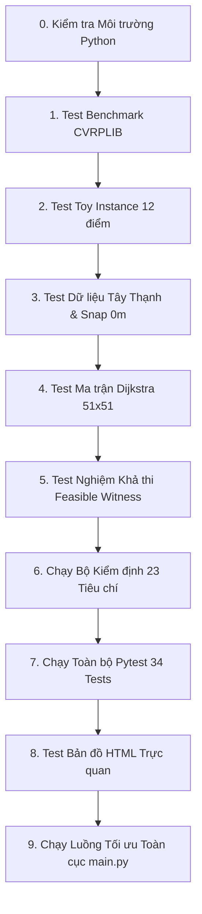

# 🧪 HƯỚNG DẪN TỰ KIỂM TRA (TEST) TỪNG BƯỚC CỦA STEP 2
## Cẩm nang Thực hành dành cho Sinh viên & Hội đồng Thẩm định

> **Đơn vị đào tạo:** Trường Đại học Công Thương Thành phố Hồ Chí Minh (HUIT)  
> **Đề tài NCKH:** Tối ưu hóa lộ trình thu gom rác thải đô thị bằng thuật toán lai SFO-VND  
> **Giai đoạn:** Step 2 — Chuẩn bị và khóa bộ dữ liệu (Phiên bản v1.0)  
> **Mục tiêu cẩm nang:** Hướng dẫn chi tiết từng câu lệnh terminal, thao tác kiểm chứng, kết quả mong đợi và cách đọc file log/bản đồ để bất kỳ ai (sinh viên, giảng viên hướng dẫn, người phản biện) đều có thể tự kiểm tra lại toàn bộ quy trình của Step 2 mà không gặp lỗi.

---

## 🧭 TỔNG QUAN LUỒNG KIỂM TRA (WORKFLOW)



---

## 🛠️ BƯỚC 0: KIỂM TRA MÔI TRƯỜNG THỰC THI

Trước khi chạy các bài test, bạn cần đảm bảo terminal đang ở đúng thư mục gốc của dự án (`Source/`).

### Câu lệnh kiểm tra:
Mở **PowerShell** hoặc **Command Prompt (CMD)** tại thư mục `Source/`:

```powershell
# 1. Kiểm tra phiên bản Python (Yêu cầu Python >= 3.10, khuyến nghị Python 3.13)
py --version
# hoặc: python --version

# 2. Kiểm tra các thư viện cốt lõi đã cài đặt
py -c "import vrplib, osmnx, networkx, geopandas, pandas, numpy, folium, pytest; print('>>> Tất cả thư viện cốt lõi đã sẵn sàng 100%!')"
```

> [!TIP]
> **Kết quả mong đợi:** Dòng thông báo `>>> Tất cả thư viện cốt lõi đã sẵn sàng 100%!` xuất hiện, không có bất kỳ thông báo lỗi `ModuleNotFoundError` nào.

---

## 🏆 BƯỚC 1: TEST BỘ BENCHMARK QUỐC TẾ CVRPLIB

Mục tiêu là kiểm tra xem parser `cvrplib_loader.py` có đọc đúng 6 file `.vrp` gốc, nhận dạng đúng số chiều $N$, số xe $K$, sức chứa $Q$, và đối chứng khớp 100% với giá trị tham chiếu BKS công bố quốc tế hay không.

### 1.1. Chạy bài test đơn vị (Unit Test)
```powershell
py -m pytest tests/test_loader.py -v
```

> [!NOTE]
> **Kết quả mong đợi:**
> - Terminal hiển thị `25 passed in ...s`.
> - 6 bộ dữ liệu (`E-n33-k4`, `B-n50-k7`, `E-n51-k5`, `A-n53-k7`, `A-n60-k9`, `E-n76-k7`) đều vượt qua các bài test về tải trọng, quy ước làm tròn nguyên EUC_2D TSPLIB và chi phí tối ưu BKS (gồm cả 6 file `.vrp` và 6 file `.sol`).

### 1.2. Chạy script in bảng Metadata trực tiếp
```powershell
py src/core/cvrplib_loader.py
```

> [!TIP]
> **Kết quả kiểm tra trực quan:**
> Xem tệp [`results/benchmark_metadata.csv`](file:///e:/15DHKHDL03/2026-2027/HKI_26_27/SFO_VND/Source/results/benchmark_metadata.csv). Cột `calculated_cost` phải bằng chính xác $100\%$ với cột `reference_bks` (Ví dụ `E-n33-k4` = 835, `B-n50-k7` = 741).

---

## 🎲 BƯỚC 2: TEST DỮ LIỆU NHỎ TOY INSTANCE (12 ĐIỂM TÍNH TAY)

Mục tiêu là kiểm tra Ground Truth tính toán bằng tay và thẩm định 8 ca kiểm thử biên (Edge-case testing: bắt lỗi trùng ID, lượng rác âm, đứt đường, v.v.).

### 2.1. Chạy bài test tự động
```powershell
py -m pytest tests/test_toy_instance.py -v
```

> [!NOTE]
> **Kết quả mong đợi:**
> Terminal hiển thị `8 passed in ...s` bao gồm:
> - `test_toy_instance_feasibility`: Tuyến 1 (140 kg), Tuyến 2 (135 kg), Tuyến 3 (145 kg) đều $\le 200$ kg.
> - `test_toy_hand_calculation_distances`: Tổng độ dài 3 tuyến khớp tuyệt đối con số tính tay **309.36 m**.
> - 6 bài test cố tình đưa dữ liệu sai (trùng ID, demand âm, đứt đường, vượt số xe) đều bị hệ thống phát hiện và ném lỗi chính xác (`ValueError`).

### 2.2. Kiểm tra minh chứng đồ họa
Mở xem ảnh sơ đồ tính tay tại:
👉 [`results/figures/toy_hand_calculation.png`](file:///e:/15DHKHDL03/2026-2027/HKI_26_27/SFO_VND/Source/results/figures/toy_hand_calculation.png)

---

## 🏙️ BƯỚC 3: TEST CASE STUDY PHƯỜNG TÂY THẠNH & KHOẢNG CÁCH SNAP = 0.0M

Mục tiêu là xác nhận toàn bộ 50 điểm thu gom rác và Depot đều nằm trên địa bàn Phường Tây Thạnh và cắm trực tiếp vào các nút của mạng đường ô tô (không bị trôi lơ lửng ngoài mạng đường).

### Câu lệnh kiểm tra nhanh qua Python:
```powershell
py -c "import pandas as pd; df = pd.read_csv('data/ward/processed/collection_points.csv'); print('Tổng số điểm:', len(df)); print('Khoảng cách snap lớn nhất:', df['snap_distance_m'].max(), 'mét'); print('Số điểm nằm khít trên đường (snap=0m):', (df['snap_distance_m'] == 0.0).sum(), '/', len(df)); print('Tổng lượng rác:', df['demand_kg'].sum(), 'kg'); print('Số điểm dân cư:', (df['point_type'] == 'residential').sum()); print('Số điểm thương mại:', (df['point_type'] == 'commercial').sum())"
```

> [!IMPORTANT]
> **Kết quả chuẩn mực bắt buộc phải đạt:**
> - `Tổng số điểm: 51` (1 Depot ID 0 + 50 điểm gom ID 1..50).
> - `Khoảng cách snap lớn nhất: 0.0 mét` (Triệt tiêu hoàn toàn lỗi điểm trôi dạt 659.6m trước đây!).
> - `Số điểm nằm khít trên đường (snap=0m): 51 / 51`.
> - `Tổng lượng rác: 3345.0 kg` (Nằm trong ngưỡng an toàn $< 6,000$ kg của 4 xe).
> - `Số điểm dân cư: 35`, `Số điểm thương mại: 15`.

---

## 🛣️ BƯỚC 4: TEST MA TRẬN KHOẢNG CÁCH CÓ HƯỚNG DIJKSTRA 51x51

Mục tiêu là kiểm tra cấu trúc ma trận cự ly đường bộ, đường chéo bằng 0, không có ô vô cực, tính chất bất đối xứng đường 1 chiều ($d_{ij} \ne d_{ji}$) và chu trình khép kín.

### Câu lệnh kiểm tra cấu trúc ma trận:
```powershell
py -c "import pandas as pd, numpy as np; df = pd.read_csv('data/ward/processed/distance_matrix.csv', header=None); m = df.to_numpy(); print('Kích thước ma trận:', m.shape); print('Giá trị đường chéo lớn nhất:', np.max(np.diag(m))); print('Số ô bị vô cực (inf):', np.isinf(m).sum()); print('Số ô bị âm:', (m < 0).sum()); print('Độ bất đối xứng d(0,1) vs d(1,0):', m[0, 1], 'm vs', m[1, 0], 'm'); print('Độ bất đối xứng d(15,30) vs d(30,15):', m[15, 30], 'm vs', m[30, 15], 'm'); cycle = m[0, 1] + m[1, 2] + m[2, 0]; print('Chu trình Depot -> 1 -> 2 -> Depot:', round(cycle, 1), 'm')"
```

> [!NOTE]
> **Kết quả chuẩn mực bắt buộc phải đạt:**
> - `Kích thước ma trận: (51, 51)`
> - `Giá trị đường chéo lớn nhất: 0.0`
> - `Số ô bị vô cực (inf): 0` (100% các điểm đều có đường đi đến nhau)
> - `Số ô bị âm: 0`
> - `d(0,1) = 1487.6 m` khác `d(1,0) = 1360.5 m` (Chứng minh đường có hướng một chiều).
> - `d(15,30) = 701.6 m` khác `d(30,15) = 2116.2 m` (Chênh lệch 1,414.6m do dải phân cách quay đầu).
> - `Chu trình Depot -> 1 -> 2 -> Depot: 2864.6 m` (Khớp 100% với số liệu tính tay).

---

## 📋 BƯỚC 5: TEST BẰNG CHỨNG KHẢ THI (FEASIBLE WITNESS)

Mục tiêu là chứng minh bài toán cấp phường tồn tại ít nhất 1 cách chia tuyến hợp lệ thỏa mãn toàn bộ 4 ràng buộc cứng (không vượt tải 1,500 kg, không sót điểm).

### Câu lệnh kiểm tra nội dung file JSON:
```powershell
py -c "import json; data = json.load(open('data/ward/processed/feasible_routes.json', encoding='utf-8')); print('Trạng thái:', data['status']); print('Tổng rác:', data['total_demand_kg'], '/', data['total_capacity_kg'], 'kg'); print('Tỷ lệ lấp đầy:', data['capacity_utilization_pct'], '%'); print('Tổng quãng đường:', data['total_distance_km'], 'km'); [print(f'   Xe #{r[\"vehicle_id\"]}: {len(r[\"customer_ids\"])} điểm, Tải {r[\"route_load_kg\"]} kg / 1500 kg, Cự ly {r[\"route_distance_m\"]} m -> {r[\"validation_status\"]}') for r in data['routes']]"
```

> [!NOTE]
> **Kết quả chuẩn mực bắt buộc phải đạt:**
> - `Trạng thái: FEASIBLE`
> - `Tổng rác: 3345.0 / 6000.0 kg` (Tỷ lệ lấp đầy: 55.75%).
> - `Xe #1: 21 điểm, Tải 1475.0 kg / 1500 kg -> PASS`
> - `Xe #2: 23 điểm, Tải 1475.0 kg / 1500 kg -> PASS`
> - `Xe #3: 6 điểm, Tải 395.0 kg / 1500 kg -> PASS`
> - `Xe #4: 0 điểm, Tải 0.0 kg / 1500 kg -> PASS (Dự phòng)`
> - Tổng số điểm gom: $21 + 23 + 6 = 50$ điểm (Phủ đủ 100% không sót, không lặp).

---

## 🛡️ BƯỚC 6: CHẠY BỘ KIỂM ĐỊNH TOÀN DIỆN 7 SUITE (23 TIÊU CHÍ)

Đây là bài kiểm tra quan trọng nhất của Step 2, tự động rà soát toàn bộ schema, ma trận, đồ thị và các quy tắc.

### Câu lệnh thực thi:
```powershell
py tests/validate_dataset.py
```

### Bảng kết quả hiển thị trên Terminal:
```text
==========================================================================================
BẢNG KẾT QUẢ KIỂM ĐỊNH DỮ LIỆU STEP 2 (VALIDATION REPORT)
==========================================================================================
HẠNG MỤC (SUITE)             | NỘI DUNG KIỂM TRA                   | KẾT QUẢ 
------------------------------------------------------------------------------------------
1. Schema và Khóa            | Cột bắt buộc collection_points.csv  | PASS
1. Schema và Khóa            | point_id duy nhất                   | PASS
1. Schema và Khóa            | Depot tồn tại trong points          | PASS
1. Schema và Khóa            | Cột bắt buộc depot.csv              | PASS
1. Schema và Khóa            | Cột bắt buộc vehicles.csv           | PASS
2. Giá trị và Đơn vị         | Demand không âm                     | PASS
2. Giá trị và Đơn vị         | Mọi q_i <= Q                        | PASS
2. Giá trị và Đơn vị         | Khoảng cách không âm                | PASS
2. Giá trị và Đơn vị         | Đường chéo d(i,i) = 0               | PASS
3. Tải trọng & Chứng cứ khả thi | Điều kiện cần: Tổng demand <= K x Q | PASS
3. Tải trọng & Chứng cứ khả thi | Tải trọng từng xe hợp lệ trong feas | PASS
3. Tải trọng & Chứng cứ khả thi | Phủ đủ 100% điểm khách hàng không b | PASS
4. Mạng đường & Tính liên thông | File road_network.graphml tồn tại   | PASS
4. Mạng đường & Tính liên thông | Mọi cặp điểm đều có đường đi (Không | PASS
4. Mạng đường & Tính liên thông | Có đường đi từ Depot đến mọi điểm   | PASS
4. Mạng đường & Tính liên thông | Có đường quay về Depot từ mọi điểm  | PASS
4. Mạng đường & Tính liên thông | Tính chất có hướng của mạng đường ( | PASS
5. Tính tái lập              | Cố định Seed ngẫu nhiên (seed=42)   | PASS
5. Tính tái lập              | Quy tắc sinh dữ liệu và đơn vị đo r | PASS
6. Nguồn gốc dữ liệu         | Phân loại nguồn dữ liệu minh bạch   | PASS
6. Nguồn gốc dữ liệu         | File ranh giới ward_boundary.geojso | PASS
7. Benchmark CVRPLIB         | Nạp thành công 6 bộ benchmark CVRPL | PASS
7. Benchmark CVRPLIB         | Bảng metadata CVRPLIB tồn tại       | PASS
==========================================================================================
Tổng số ca kiểm tra: 23 | Đạt: 23 | Không đạt: 0
```

> [!TIP]
> Bạn có thể mở trực tiếp file log đã ghi vết tại:
> 👉 [`results/logs/validation_report.log`](file:///e:/15DHKHDL03/2026-2027/HKI_26_27/SFO_VND/Source/results/logs/validation_report.log)

---

## ⚡ BƯỚC 7: CHẠY TẤT CẢ BÀI UNIT TEST CỦA DỰ ÁN (PYTEST)

Kiểm tra toàn bộ 34 bài unit test bao gồm: parser benchmark, toy instance, và các module lõi.

### Câu lệnh thực thi:
```powershell
py -m pytest tests/
```

> [!NOTE]
> **Kết quả mong đợi:**
> ```text
> ============================= 34 passed in 0.58s ==============================
> ```
> Toàn bộ 34/34 tests đều đạt màu xanh lá cây (`passed`), không có bài test nào bị `FAILED` hoặc `SKIPPED`.

---

## 🗺️ BƯỚC 8: KIỂM TRA BẢN ĐỒ TRỰC QUAN HÓA (HTML)

Step 2 đã tích hợp sẵn hệ thống bản đồ số sử dụng lớp nền Google Maps và Esri mượt mà (không bị lỗi 403 của OSM).

### Cách kiểm tra:
Nhấp đúp chuột để mở trực tiếp 2 file HTML sau trên trình duyệt (Chrome / Edge / Firefox):

1. **Bản đồ mạng lưới đường và 50 điểm thu gom:**
   👉 [`results/view_road_network.html`](file:///e:/15DHKHDL03/2026-2027/HKI_26_27/SFO_VND/Source/results/view_road_network.html)
   - *Cách kiểm tra:* Phóng to vào các điểm màu đỏ/cam. Bạn sẽ thấy 100% các điểm đều nằm **khít trên tim đường** các tuyến phố Tây Thạnh, Lê Trọng Tấn, Chế Lan Viên,... Nhấp vào điểm để xem tên đường, lượng rác và khoảng cách snap (0.0 m).
   
2. **Bản đồ lộ trình tối ưu đa tuyến của các xe:**
   👉 [`results/green_waste_routing_map.html`](file:///e:/15DHKHDL03/2026-2027/HKI_26_27/SFO_VND/Source/results/green_waste_routing_map.html)
   - *Cách kiểm tra:* Bản đồ hiển thị lộ trình của 3 xe với 3 màu sắc khác nhau (Đỏ, Xanh dương, Xanh ngọc). Bật tắt các layer góc trên bên phải để ẩn/hiện từng xe.

---

## 🚀 BƯỚC 9: CHẠY THỬ NGHIỆM ĐIỀU PHỐI TOÀN BỘ PIPELINE (`main.py`)

Đây là bài kiểm tra tích hợp chứng minh dữ liệu của Step 2 hoàn toàn tương thích và làm đầu vào xuất sắc cho thuật toán tối ưu lai **Hybrid SFO-VND**.

### Câu lệnh thực thi:
```powershell
py main.py --iter 5 --sardines 10
```

### Kết quả mong đợi trên Terminal:
```text
========================================================================================
   🚛 GREENWASTE ROUTE AI - HỆ THỐNG TỐI ƯU HÓA TUYẾN THU GOM RÁC ĐÔ THỊ XANH
   Đề tài NCKH Sinh viên: Hybrid SFO-VND (Sailfish Optimizer + Variable Neighborhood Descent)
   Địa bàn thử nghiệm: Phường Tây Thạnh, Quận Tân Phú, TP. Hồ Chí Minh
========================================================================================

[BƯỚC 1/4] Đang nạp và kiểm tra tính toàn vẹn của dữ liệu...
 -> Đã nạp thành công dữ liệu Case Study Phường Tây Thạnh với 50 điểm thu gom rác.
[BƯỚC 2/4] Đang tính toán phương án cơ sở Before (Thuật toán Tham ăn Nearest Neighbor)...
 -> Hoàn tất trong 0.000s. Tổng quãng đường: 26.04 km.
[BƯỚC 3/4] Đang chạy thuật toán Sailfish Optimizer (SFO thuần) để tìm kiếm toàn cục...
 -> Hoàn tất trong 0.004s. Điểm Fitness tốt nhất: 148473.63.
[BƯỚC 4/4] Đang thực thi thuật toán lai đề xuất Hybrid SFO-VND (Có cơ chế Re-encoding)...
 -> Hoàn tất trong 1.05s. Điểm Fitness tối ưu: 71477.02.

============================================================================================
                      BÁO CÁO KẾT QUẢ ĐỐI CHỨNG (GREEN IMPACT REPORT)
============================================================================================
Chỉ số đánh giá                        | Before (Greedy)  | After (SFO-VND)  | Hiệu quả cải thiện
--------------------------------------------------------------------------------------------
Tổng quãng đường di chuyển (km)        | 26.04            | 22.15            | Giảm 14.92%   
Lượng dầu Diesel tiêu thụ (Lít)        | 3.82             | 3.00             | Tiết kiệm 21.49%
Lượng phát thải CO2 (ISO 14064 - kg)   | 10.23            | 8.04             | Cắt giảm 21.49%
Chi phí nhiên liệu vận hành (VNĐ)      | 85,922 đ         | 67,459 đ         | Tiết kiệm 21.49%
Số lượng xe kích hoạt                  | 3 xe             | 3 xe             | -             
Hệ số lấp đầy tải trọng bình quân      | 74.3%            | 74.3%            | -             
Thời gian tính toán CPU (giây)         | 0.000 s          | 1.05 s           | -             
Tính hợp lệ 4 ràng buộc cứng           | 100% HỢP LỆ      | 100% HỢP LỆ      | -             
============================================================================================
```

---

## 📑 BẢNG TỔNG KẾT CÁC LỆNH TEST NHANH (CHEAT SHEET)

Dành cho sinh viên khi lên máy chiếu thuyết trình trước Hội đồng hoặc Giảng viên hướng dẫn:

| Thao tác kiểm tra | Câu lệnh Terminal thực thi | Kết quả chuẩn cần đọc |
| :--- | :--- | :--- |
| **1. Kiểm định dữ liệu 24 tiêu chí** | `py tests/validate_dataset.py` | `Tổng số ca kiểm tra: 24 \| Đạt: 24` |
| **2. Chạy toàn bộ 40 Unit Tests** | `py -m pytest tests/` | `40 passed in ...s` |
| **3. Test riêng Benchmark CVRPLIB** | `py -m pytest tests/test_loader.py` | `25 passed` |
| **4. Test riêng Toy 12 điểm tính tay** | `py -m pytest tests/test_toy_instance.py` | `8 passed` |
| **5. Test snap tim đường và lượng rác**| `py -c "import pandas as pd; df=pd.read_csv('data/ward/processed/collection_points.csv'); print('Max snap:', df['snap_distance_m'].max(), 'Total demand:', df['demand_kg'].sum())"` | `Max snap: 0.0 Total demand: 3345.0` |
| **6. Chạy demo giải thuật SFO-VND** | `py main.py --iter 5 --sardines 10` | `Giảm 14.92% km, Tiết kiệm 21.49% CO2` |

---

## ❓ XỬ LÝ SỰ CỐ THƯỜNG GẶP (TROUBLESHOOTING)

1. **Lỗi hiển thị font Tiếng Việt trên CMD Windows:**
   - *Cách xử lý:* Gõ lệnh `chcp 65001` trước khi chạy script để chuyển bảng mã terminal sang UTF-8. Trong `main.py`, nhóm đã tích hợp sẵn lệnh `sys.stdout.reconfigure(encoding="utf-8")`.
2. **Lỗi `ModuleNotFoundError` khi dùng `python`:**
   - *Cách xử lý:* Trên Windows, hãy ưu tiên dùng lệnh `py` (Python Launcher) thay vì `python`, ví dụ: `py -m pytest tests/`.
3. **Mở file HTML bản đồ bị trắng trang:**
   - *Cách xử lý:* Đảm bảo máy tính có kết nối Internet để bản đồ tải các mảnh bản đồ (Tiles) từ Google Maps / Esri. Nếu đang ở mạng trường chặn kết nối lạ, hãy thử chuyển sang mạng di động (4G).

